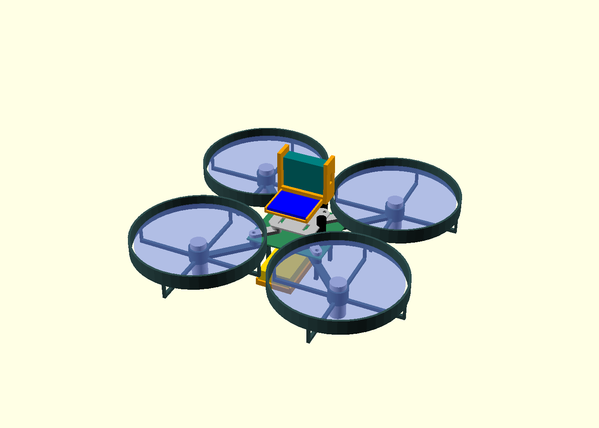

# Scout 110-B prototype A assembly package

The carrier and printable parts are ready for **prototype fabrication and dry
fitting**. They have electrical/layout and mesh checks, not physical approval.
Use this package with the purchased XIAO ESP32-S3 **Sense**, GY-521, four 8520
motors, matching 65 mm/1 mm props and one 1S BT2.0 pack from the
[procurement table](README.md). Do not install an onboard inference computer.



The colored module envelopes in this rendering are provisional. Camera board
revision, lens protrusion, USB access, antenna cable and actual battery size
must be checked against the delivered parts. The design is 148.2 mm across its
guards, with a 110 mm diagonal motor spacing. Motors are shown only as envelopes;
the translucent disks show the nominal propeller sweep.

## Fabrication files

| Deliverable | File / specification |
| --- | --- |
| Editable circuit | [KiCad schematic](carrier/scout-carrier.kicad_sch), [SVG](carrier/scout-carrier.svg) |
| Editable board | [KiCad PCB](carrier/scout-carrier.kicad_pcb), [top view](carrier/board-top.svg) |
| Fabrication | [Gerber/drill archive](carrier/scout-carrier-prototype-a-gerbers.zip): 42 × 40 mm, 2 layers, **1.0 mm FR4, 2 oz copper on both layers**, lead-free HASL or ENIG, no assembly service |
| Electrical checks | [DRC](carrier/drc.json), [ERC](carrier/erc.json), [65-pin schematic/PCB parity](carrier/connectivity-check.json) |
| Part positions, nets and packages | [Assembly netlist/BOM](carrier/netlist.json) |
| Printable frame | [STL](mechanics/scout-frame-a.stl), [editable SCAD](mechanics/scout-frame-a.scad) |
| Electronics bridge | [STL](mechanics/electronics-bridge-a.stl), [SCAD](mechanics/electronics-bridge-a.scad) |
| Forward camera cradle | [STL](mechanics/camera-cradle-a.stl), [SCAD](mechanics/camera-cradle-a.scad) |
| IMU tray | [STL](mechanics/imu-tray-a.stl), [SCAD](mechanics/imu-tray-a.scad) |
| Battery cradle | [STL](mechanics/battery-cradle-a.stl), [SCAD](mechanics/battery-cradle-a.scad) |
| Nominal rotor clearance | [Rigid mesh/rotor separation](mechanics/rotor-clearance.json); 1.43 mm minimum frame/guard gap in the modeled rotor slab |
| Mesh checks | [Closed surfaces, connected parts, volumes and hashes](mechanics/mesh-checks.json) |

Gerbers do not encode the fabrication copper weight: explicitly request 2 oz.
The power bus is 2.4 mm wide; motor branches, source vias, joints, MOSFETs and
battery wiring all need loaded current/temperature tests. Zero DRC errors does
not prove thermal capacity. Use the board as a prototype, not an approved
production power stage. The board has no battery protection or current sensor.

KiCad 10.0.7 produced the circuit/board exports. Pinned footprint copies and
[their license](carrier/footprints/LICENSE.md) accompany the design; see
[provenance](carrier/provenance.json). `generate_carrier.py` uses KiCad's pcbnew
Python and gates Gerber export on DRC. `generate_schematic.py` reconstructs the
schematic from the same netlist; the separately exported schematic netlist is
compared pin-for-pin to the PCB. No private keys or model weights are packaged.

## Populate the carrier

| References | Quantity | Part / package | Polarity or placement |
| --- | ---: | --- | --- |
| Q1–Q4 | 4 | AO3400A, SOT-23 | Pin 1 gate, 2 source/GND, 3 drain/motor− |
| D1–D4 | 4 | SS34, SMA | **Cathode stripe toward VBAT / right-hand pad**, anode to motor− |
| R1–R4 | 4 | 100 ohm, 0805 | Series gate resistance |
| R5–R8 | 4 | 10 kohm, 0805 | Gate pulldown to ground |
| R9–R10 | 2 | 100 kohm, 1%, 0805 | R9 VBAT to ADC; R10 ADC to GND |
| C1 | 1 | 470 uF, 10 V, radial; 6.3 mm body, 2.5 mm pitch | Positive square pad to VBAT; check purchased dimensions/height |
| C2 | 1 | 47 uF, 10 V, radial; 5 mm body, 2 mm pitch | Positive square pad to VBAT; check purchased dimensions/height |
| C3–C4 | 2 | 100 nF, 0805 | Supply decoupling and ADC filter |
| At motor terminals | 4 | 100 nF ceramic | One directly across each motor; not on the carrier |
| J1–J17 | — | Soldered wire pads | No large pin headers required |

Use short supplied motor leads. Bring main battery current through the BT2.0
pigtail directly to J13/J14; **never through XIAO traces, USB 5 V or its 3V3 pin**.
Make all grounds common at the carrier. Inspect diode stripes, capacitor
polarity, MOSFET orientation and every joint before power. Check no short from
VBAT to GND or any gate to VBAT. Remove propellers for all first-power work.

## Wiring and motor orientation

Viewed from above, forward is the camera direction (+Y in the mechanical files).
The controller's FLU axes are +X forward, +Y left, +Z up. Align the GY-521 raw
axes accordingly or set the measured signed rotation in commissioning.

```text
                       FORWARD / CAMERA
              M4 CCW                    M1 CW
              GPIO7                     GPIO1

              M3 CW                     M2 CCW
              GPIO4                     GPIO2
```

| Carrier / module connection | Destination |
| --- | --- |
| J1 PWM1 | XIAO D0 / GPIO1 |
| J2 PWM2 | XIAO D1 / GPIO2 |
| J3 PWM3 | XIAO D3 / GPIO4 |
| J4 PWM4 | XIAO D8 / GPIO7 |
| J5, J6, J7, J8 | M1−, M2−, M3−, M4− respectively |
| J9, J10, J11, J12 | M1+, M2+, M3+, M4+ respectively |
| J13 / J14 | Battery pigtail + / −; verify connector polarity with a meter |
| J15 / J16 | XIAO underside BAT+ / GND |
| J17 | XIAO D10 / GPIO9 battery ADC |
| GY-521 SDA / SCL | XIAO D4/GPIO5 / D5/GPIO6 |
| GY-521 AD0 / GND | GND / GND; address 0x68 |
| GY-521 supply | XIAO 3V3, **only after verifying the actual module's regulator, input requirements and 3.3 V I2C levels** |
| Camera | Supplied Sense board connector; keep its ribbon/stack and antenna clear |

GY-521 boards vary. Confirm the sensor's rail is valid when supplied with 3.3 V;
a module regulator with excessive dropout must be corrected/replaced before
use. Do not solve that by putting 5 V pullups on ESP32 pins. No SD card is used.
The firmware uses I2C0 for the IMU; the pinned ESP32 camera library uses I2C1.
CW/CCW above means actual rotation seen from above, not wire color. Match each
handed propeller after testing direction with the propellers removed.

## Mechanical stack and dry fit

Print one of each STL. Use the editable dimensions to match the delivered
modules and printer. The meshes are each closed and connected; stiffness,
layer adhesion and motor-grip tolerance are not established by mesh checks.
Do not assume a particular infill gives a known mass or strength.

1. Dry-fit the four 8.5 mm motor bodies into nominal 8.6 mm bores. Check shaft
   height against the nominal Z=12 mm prop plane and retention without crushing
   the motor can. Verify at least the designed nominal guard gap through a full
   hand rotation. Keep wires and capacitors below/outside the swept disks.
2. Fit the carrier at Z=5 mm on its four frame bosses. Its four 2.2 mm holes
   match the asymmetric frame/bridge pattern; do not mirror it. Board coordinates
   transform as X=PCB-X−21, Y=PCB-Y−20. The J13/J14 edge faces mechanical +Y.
3. Use four nylon M2 screws with insulating washers/spacers: frame boss top
   Z=5, PCB top Z=6, bridge base Z=7. The bridge's central deck is Z=22–23,
   clearing the provisional capacitor envelopes below it. Choose screw length
   after checking thread engagement; keep metal away from traces and rotor disks.
4. Bolt the camera cradle at X=0, Y=8, Z=23 using its two M2 holes and strap the
   XIAO Sense stack without covering the lens, USB connector or antenna. The
   camera must face forward; the actual camera-to-IMU transform is measured later.
5. Retain the IMU tray at X=0, Y=−7, Z=23 with nonconductive fastening. Keep the
   IMU rigidly located relative to the camera. Do not independently float the IMU
   on soft foam: an unknown moving camera/IMU transform invalidates VIO calibration.
6. Strap the battery cradle below the center plate at Z=−12; its nominal pack
   envelope is 62 × 18 × 8 mm. The revised feet are spaced outside the cradle.
   Leave the connector accessible and provide strain relief. Do not puncture,
   compress or heat the pouch. Recheck balance after all wiring is fitted.

The five solid meshes imply **about 25.1 g at an assumed 1.27 g/cm³ PETG density**.
That is a geometric estimate, not a measured print mass. It excludes PCB,
electronics, battery, motors, fasteners and wiring. The old 63.26 g simulation
profile therefore cannot be treated as the as-built mass of this revised stack.
Weigh each part, measure the center of mass, create measured SQLite revisions,
and rerun the model before qualifying a hover. A tiny frame's guard is not a
substitute for a restrained bench test enclosure.

## First power and flight readiness

Charge the initial 1S pack to **at most 4.20 V**. Use the external charger from
the procurement guide. Disconnect the flight battery for the initial USB-only
flash/inspection; keep motors disconnected. Verify battery voltage and polarity
before the battery-powered camera/IMU tests. No automatic launch is available.

Follow the [firmware and commissioning guide](../../flight/README.md): safe
build → connect/record → propeller-free motor checks → measured sensor/power
checks → restrained tuning → independently reviewed short hover. Real
position/height feedback and its failure behavior must be established before
room navigation. All physical measurements remain outstanding until parts arrive.
